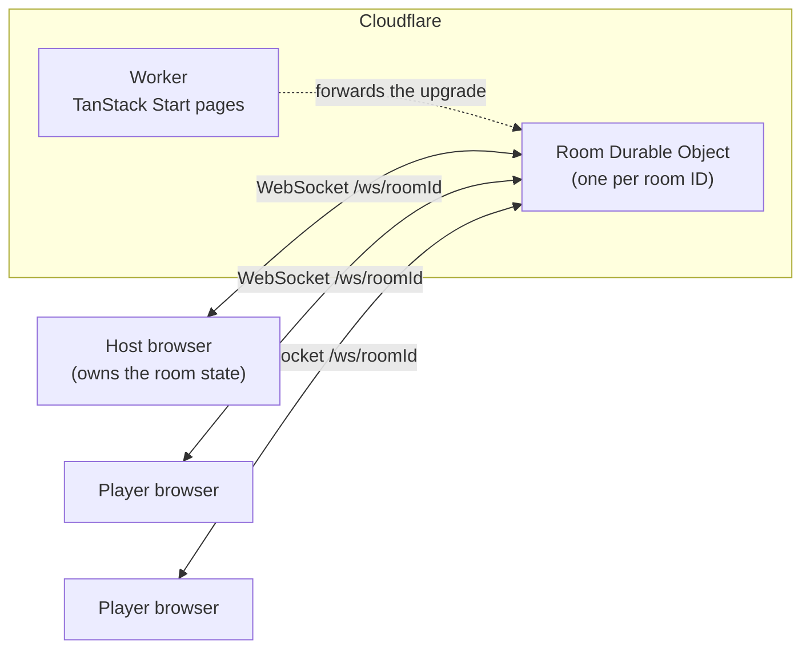

# Scrum Poker sous la Mer

Planning poker for scrum teams, with an under-the-sea theme. A host opens a room and shares a link. Players join from any browser and vote on story points. The host reveals all the votes at once.

Live at [scrumpoker.foo](https://scrumpoker.foo). Built with TanStack Start on Cloudflare Workers, with one Durable Object per room.

## Contents

- [Playing a round](#playing-a-round)
- [Host controls](#host-controls)
- [Demo mode](#demo-mode)
- [How it works](#how-it-works)
- [Development](#development)
- [Deploying](#deploying)
- [Project layout](#project-layout)

## Playing a round

### Host

1. Go to `/host`, enter your first name and click **Create New Room**.
   - The players' room link is copied to your clipboard.
   - To reopen the room you used last time, click **Click to Use Last Room** instead.
2. Click **Go to New Room**. This opens the host page at `/host/<roomId>`.
3. Share the players' link (`/<roomId>`). **Copy User Room URL** copies it again.
4. When everyone has voted, click **Show points**. The cards flip over and sort from highest to lowest, and voting locks.
5. Click **Clear Points** to start the next story.

### Players

1. Open the link from the host.
2. Enter your first name and click **Join Room**.
3. Pick a story point. Your card shows that you voted, but not what you voted, until the host clicks **Show points**.

The site remembers each player's name. After a reload, a returning player sees **Welcome back** and clicks **Join Room** again. **Change Name** lets them join under a different name.

## Host controls

| Control          | Where        | What it does                                                          |
| ---------------- | ------------ | --------------------------------------------------------------------- |
| **Show points**  | Host page    | Reveals and sorts every vote, and locks voting                        |
| **Clear Points** | Host page    | Resets every vote to blank and unlocks voting                         |
| **Create Room**  | Top left     | Goes back to `/host` to create a new room                             |
| Gear icon        | Top right    | Opens **Host Settings**                                               |
| Fish icon        | Bottom right | Sends a fish swimming across your screen; click again to send it away |

**Host Settings** has:

- **Host Room URL** and **Users Room URL** for the current room.
- **Show / Hide Host Card?**
  - **Hide** (the default): the host runs the room without voting.
  - **Show**: the host gets a card and votes like a player.
- **Select ALL Allowed Story Points:** the point values players can choose from. The default is `? 0 1 2 3 5 8 13 20 40 100`. Click **Save & Close** to send the change to every player.
- **Motion / Animation?**
  - **Minimum**, **Medium** (the default) or **High**.
  - Sets how much the cards move when they appear and flip.
  - Applies to everyone in the room.
- **Clear All Users Data:** deletes everything this site has saved in your browser, then reloads the page. This can't be undone.

## Demo mode

Demo mode fills a room with fake players, so you can show the app without gathering a team.

### Turning it on

Create a room with a host name that contains the word `demo`, in any capitalization. You can add two optional numbers to the name, separated by dashes:

```text
Demo-<number of fake players>-<percent who have voted>
```

| Host name    | Fake players | Share who have voted |
| ------------ | ------------ | -------------------- |
| `Demo`       | 10 (default) | about 50% (default)  |
| `Demo-20`    | 20           | about 50%            |
| `Demo-20-80` | 20           | about 80%            |
| `Demo-6-100` | 6            | all of them          |

### Demo buttons

In demo mode, three buttons appear at the top left of the host page, next to **Create Room**:

- **Add**
  - Adds the fake players.
  - Their names are picked from a list of about 195 first names and start with `*` (for example `*Linda`), so they're easy to tell apart from real players.
  - Each fake player has either voted a random allowed point value or not voted yet. The percent in the host name sets the odds.
  - The fake players go to everyone in the room, so real players see them too.
  - **Add** works once; click **Delete** before adding again.
- **Delete**: removes the fake players by putting the player list back exactly as it was when you clicked **Add**. Votes that real players cast after that point are also put back.
- **End Demo**: deletes all the data this site saved in your browser (the same as **Clear All Users Data**) and returns to `/host`.

### Good to know

- Real players can join a demo room and vote alongside the fake ones.
- Each fake player gets a random "last active" time within the past 30 minutes.
  - The room drops anyone who has been inactive for 30 minutes, the next time a player votes or joins.
  - So fake players start dropping out within half an hour.
  - For a longer demo, click **Delete** and then **Add** to get a fresh set.

## How it works

### The big picture



- **The Worker** (`src/worker/index.ts`):
  - Serves the 4 pages: `/`, `/host`, `/host/$roomId` and `/$roomId`.
  - Sends WebSocket upgrades on `/ws/<roomId>` to the Durable Object named after that room.
- **The Room Durable Object** (`src/worker/room.ts`):
  - Is a relay: every message it receives goes to every socket in the room, including the sender.
  - Stores nothing.
  - Uses the WebSocket Hibernation API, so an idle room costs nothing while players stay connected.
- **The host's browser owns the room**:
  - It keeps the player list and votes, the allowed points and the settings, and saves them to `localStorage`.
  - When anyone joins, the host sends the current state to the whole room.
  - So if the host reloads, the room is restored from the host's browser.
- **Pages render only in the browser** (`ssr: false` on the room routes), because the room depends on `localStorage` and a live socket.

### Messages

Every message is JSON: `{ event, roomId, message, userName, userId, timeStamp }`.

| Event                       | Sent by                        | Meaning                                                                   |
| --------------------------- | ------------------------------ | ------------------------------------------------------------------------- |
| `join-room`                 | Anyone                         | "I'm here." The host answers with the 4 events below.                     |
| `user-story-point`          | Player (or a host with a card) | A vote. The host updates the player list.                                 |
| `all-users-story-points`    | Host                           | The full player list with votes. Every browser draws its cards from this. |
| `allowed-story-points`      | Host                           | The point values players can choose from.                                 |
| `host-room-info`            | Host                           | The host's name, shown on players' screens.                               |
| `animation-setting`         | Host                           | Minimum, medium or high.                                                  |
| `show-disable-reset-points` | Host                           | `true` reveals the votes and locks voting; `false` clears them.           |

Special values for `message` in votes (`src/utils/constants.ts`):

| Value | Meaning                   |
| ----- | ------------------------- |
| `-99` | Joined, hasn't voted      |
| `-77` | Host with the card hidden |
| `-33` | Vote cleared              |
| `-1`  | `?`                       |

### Connections

`src/services/socket.tsx` keeps one WebSocket per browser tab and exposes:

- `socketEmitter(event, options)`
  - Sends a message.
  - Messages wait in a queue until the socket opens.
- `useSocketListener(event, { onChange })`: a React hook that runs `onChange` for each message with that event name.

If the connection drops, the client reconnects with backoff: 1 second at first, doubling up to 30 seconds. After reconnecting it sends `join-room` again, so the host re-sends the room state.

### What's saved in the browser

| `localStorage` key                  | Holds                                          |
| ----------------------------------- | ---------------------------------------------- |
| `scrumPokerLaMerHostData`           | Host name, host ID, room ID and both room URLs |
| `scrumPokerLaMerStoryPoints`        | The host's copy of the player list and votes   |
| `scrumPokerLaMerAllowedStoryPoints` | The allowed point values                       |
| `scrumPokerLaMerShowHostCard`       | Whether the host votes                         |
| `scrumPokerLaMerAnimationSetting`   | Minimum, medium or high                        |
| `scrumPokerLaMerUser`               | A player's name, ID and last room              |

## Development

You need Node 22 or newer and pnpm.

```sh
pnpm install
pnpm run dev            # http://localhost:3000, with the Worker and Durable Object running locally
```

To try a room locally:

1. Open `http://localhost:3000/host` and create a room.
2. Open the players' link in a second browser or a private window.

| Script                                      | What it does                                                            |
| ------------------------------------------- | ----------------------------------------------------------------------- |
| `pnpm run dev`                              | Vite dev server with the Cloudflare runtime                             |
| `pnpm run build`                            | Production build into `dist/`                                           |
| `pnpm run preview`                          | Serves the production build locally                                     |
| `pnpm run test`                             | Vitest (jsdom)                                                          |
| `pnpm run test:watch`                       | Vitest in watch mode                                                    |
| `pnpm run typecheck`                        | TypeScript for the app and for the Worker                               |
| `pnpm run lint` / `pnpm run lint:fix`       | oxlint                                                                  |
| `pnpm run format` / `pnpm run format:check` | oxfmt                                                                   |
| `pnpm run cf-typegen`                       | Regenerates `worker-configuration.d.ts` after you edit `wrangler.jsonc` |
| `pnpm run deploy`                           | `wrangler deploy` (production)                                          |

Notes:

- `src/routeTree.gen.ts` is generated by the TanStack Start plugin during `dev` and `build`. It's committed; don't edit it by hand.
- Tests use `vitest.config.ts`, separate from `vite.config.ts`, because the Cloudflare plugin can't run under Vitest.

## Deploying

There is one environment: production. The Worker is named `scrum-poker` and serves [scrumpoker.foo](https://scrumpoker.foo).

```sh
pnpm run build
pnpm run deploy
```

The Durable Object class `Room` was created by migration `v1` in `wrangler.jsonc`. If you ever rename or delete the class, add a new migration; never edit `v1`.

## Project layout

```text
src/
  routes/          Pages: /, /host, /host/$roomId, /$roomId
  pages/           The page components the routes render
  components/      UI: cards, story point buttons, dialogs, host tools and settings
  services/
    socket.tsx     Browser WebSocket client
  worker/
    index.ts       Worker entry: /ws/<roomId> → Room, everything else → TanStack Start
    room.ts        Room Durable Object (relay)
  utils/           Constants, hooks, helpers and the demo names list
  styles/          Tailwind + daisyUI styles
public/            Sea-life images, icon and cache headers
wrangler.jsonc     Worker config, Durable Object binding and migrations
```
